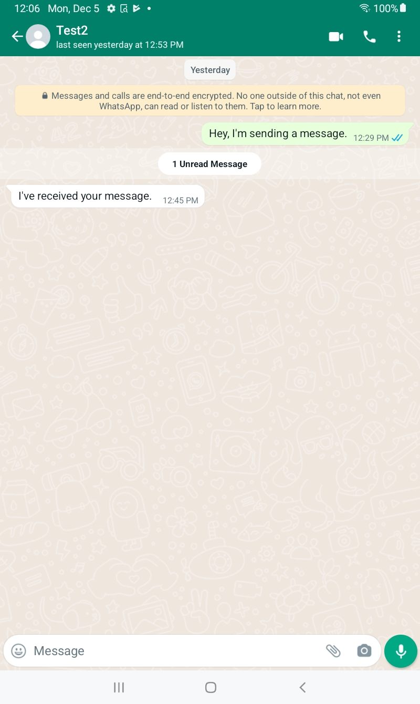
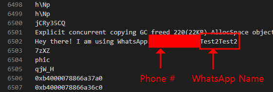
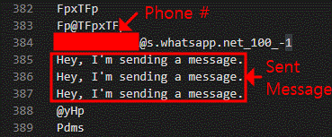
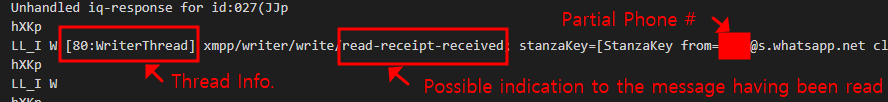
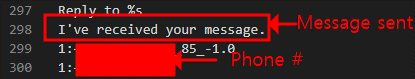
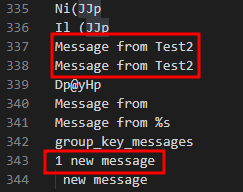
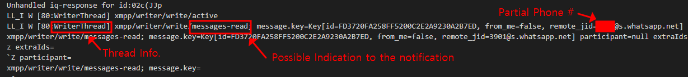
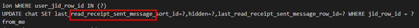

# <u>프로젝트 요약</u>

Android 기기에서 WhatsApp과 관련된 시스템 메모리 및 애플리케이션 메모리 획득을 시도하였다. 시스템 메모리 획득에는 실패했지만, 애플리케이션 메모리에서는 사용자의 특정 WhatsApp 활동을 나타낼 가능성이 있는 다양한 디지털 아티팩트를 확인하였다. 분석 대상 활동은 다음과 같다.

* 다른 사용자를 새로 추가했는지 여부
* 메시지를 전송했는지 여부
* 같은 대화방에서 다른 사용자가 보낸 메시지를 읽었는지 여부

# <u>서론</u>

이 프로젝트에서는 Android 기기의 WhatsApp을 대상으로 두 가지 메모리 획득 방법을 시도하고, 획득한 메모리 내용을 분석하였다. 두 방법은 각각 시스템 메모리 공간과 시스템에서 실행 중인 애플리케이션의 메모리 공간을 대상으로 한다.

두 가지 획득 방법을 모두 시도했지만, 시스템 메모리 획득에 실패하여 실제 분석은 애플리케이션 메모리에 한정하였다. 다만 두 방법을 시도한 과정은 모두 아래의 수행 절차에 정리하였다. 애플리케이션 메모리 분석은 주로 메모리에 남아 있는 문자열을 중심으로 진행하였다.

# <u>사용 장비 및 도구</u>

이 프로젝트에 사용한 장비와 도구는 다음과 같다. 버전 정보는 프로젝트 수행 당시의 기록이다.

| 장비·도구 | 구분 | 버전 | 용도 |
| :-- | :-- | :-- | :-- |
| Samsung Galaxy Tab A7 Lite <br> (SM-T220) | 하드웨어 | [OS] Android 12 <br> [Kernel] T220XXU1BVGB | 기기 A: 메모리 획득 및 분석의 주 대상 기기 |
| Samsung Galaxy Z Flip 4 <br> (SM-F721U1) | 하드웨어 | [OS] Android 12 <br> [Kernel] F721U1UES1AVJ7 | 기기 B: 주 대상 기기와 메시지를 주고받는 보조 기기 |
| Samsung Galaxy Book Pro 360 <br> (NP950QDB-KB1US) | 하드웨어 | [OS] Windows 10 <br> [Build] 19045.2251 | 작업용 워크스테이션 |
| SM-T220 Firmware | 소프트웨어 | T220XXU1BVGB | 루팅용 커스텀 바이너리의 기반 펌웨어 |
| Magisk | 소프트웨어 | 25.2 | 루팅용 커스텀 바이너리 생성 |
| Odin3 | 소프트웨어 | 3.14.4 | 루팅을 위해 대상 기기에 커스텀 리커버리 설치 |
| WSL2 | 소프트웨어 | Ubuntu 20.04 | 주 대상 기기의 LiME 모듈에 필요한 커널 빌드 환경 |
| SM-T220 Kernel | 소프트웨어 | T220XXU1BVGB | 주 대상 기기의 LiME 모듈 빌드에 사용할 커널 |
| LiME | 소프트웨어 | 1.9.1 | 주 대상 기기의 시스템 메모리 획득용 모듈 빌드 |
| VMware Workstation 16 Pro | 소프트웨어 | 16.2.4 | Tsurgi 실행 환경 |
| Tsurgi | 소프트웨어 | 5.4.2-050402 | 주 대상 기기의 시스템 메모리 및 애플리케이션 메모리 획득 작업 |
| Frida tools | 소프트웨어 | 15.2.2 | 애플리케이션 메모리 획득 |
| fridump | 소프트웨어 | 0.1 | 애플리케이션 메모리 획득 |
| frida-server | 소프트웨어 | 15.2.2 | 애플리케이션 메모리 획득 |
| Visual Studio Code | 소프트웨어 | 1.73.1 | 프로그램 작성 및 애플리케이션 메모리 내 문자열 분석 |

# <u>수행 절차</u>

## 1. 메모리 획득 준비

### 1.1. 워크스테이션에 필요한 소프트웨어 다운로드

**Android 기기 펌웨어**

1. [Samfrew](https://samfrew.com)에 접속한다.
2. *Model*에 `sm-t220`을 입력한다.
3. *Region*에 `United States`를 입력한다.
4. *OK* 버튼을 클릭한다.
5. 버전이 `T220XXU1BVGB`인 펌웨어를 선택하여 다운로드한다.

**Magisk**

[Magisk GitHub 릴리스 페이지](https://github.com/topjohnwu/Magisk/releases)에서 Magisk를 다운로드한다.

**Odin**

[Odin 다운로드 링크](https://www.osamsung.com/odin/Odin3-v3.14.4.zip?check=odin3.14.4)에서 Odin을 다운로드한다.

### 1.2. 주 대상 기기의 루팅 준비

**개발자 옵션 활성화**

1. *Settings(설정)*로 이동한다.
2. *About tablet(태블릿 정보)*을 선택한다.
3. *Software information(소프트웨어 정보)*을 선택한다.
4. *Build number(빌드 번호)*를 7회 눌러 *Developer options(개발자 옵션)* 메뉴를 활성화한다.

**OEM 잠금 해제 허용**

1. *Developer options*로 이동한다.
2. *OEM unlocking(OEM 잠금 해제)*을 활성화한다.

**부트로더 잠금 해제**

1. 주 대상 기기의 전원을 끈다.
2. 기기를 워크스테이션에 연결한다.
3. 화면이 켜질 때까지 볼륨 올리기와 볼륨 내리기 버튼을 함께 길게 누른다.
4. *Bootloader unlock* 모드로 전환될 때까지 볼륨 올리기 버튼을 길게 누른다.
5. 볼륨 올리기 버튼을 다시 누른다.

### 1.3. 주 대상 기기 루팅

**루팅용 커스텀 바이너리 준비**

1. 다운로드한 Magisk 파일과 펌웨어 폴더의 `AP` 파일을 주 대상 기기에 복사한다.
2. 기기에 Magisk를 설치하고 실행한다.
3. *Install*을 선택한다.
4. *Select and Patch a File*을 선택한다.
5. 복사한 `AP` 파일을 선택한다.
6. *LET'S GO*를 누른다.
7. 이름이 `magisk_patched`로 시작하는 TAR 파일을 워크스테이션에 복사한다.

**ODIN 모드로 부팅**

1. 주 대상 기기의 전원을 끈다.
2. 기기를 워크스테이션에 연결한다.
3. 화면이 켜질 때까지 볼륨 올리기와 볼륨 내리기 버튼을 함께 길게 누른다.
4. 볼륨 올리기 버튼을 누른다.

**Odin으로 커스텀 바이너리 설치**

1. 워크스테이션에서 Odin을 실행한다.
2. *BL* 버튼을 누르고 펌웨어 폴더에서 이름이 `BL_`로 시작하는 파일을 선택한다.
3. *AP* 버튼을 누르고 기기에서 복사한 `magisk_patched` 파일을 선택한다.
4. *CSC* 버튼을 누르고 펌웨어 폴더에서 이름이 `CSC_`로 시작하는 파일을 선택한다.
5. *Start*를 누른다.
6. Odin에 *PASS*가 표시되면 기기와 워크스테이션의 연결을 해제한다.

**주 대상 기기 초기화**

1. 화면이 꺼질 때까지 볼륨 내리기와 전원 버튼을 함께 길게 누른다.
2. 전원 버튼을 누른 상태에서 볼륨 내리기 대신 볼륨 올리기 버튼을 누른다.
3. *PRESS POWER KEY TO CONTINUE*가 표시되면 두 버튼에서 손을 뗀다.
4. *Wipe data/factory reset*을 선택한다.
5. *Reboot system now*를 선택한다.

**Magisk 재설치**

1. 주 대상 기기를 워크스테이션에 연결한다.
2. Magisk 파일을 기기에 복사하여 설치한다.
3. *Require Additional Setup* 메시지가 나타나면 *OK*를 누른다. 이 과정에서 기기가 재부팅된다.

### 1.4. 주 대상 기기의 설정 조정

1. Wi-Fi를 끈다.
2. Google 앱 자동 업데이트를 비활성화한다.
3. *Settings → Software update*에서 *Auto download over Wi-Fi*를 비활성화한다.
4. 앞서 설명한 개발자 옵션 활성화 절차를 다시 수행한다.
5. *Developer options*에서 다음과 같이 설정한다.
   - *Stay awake*: 활성화
   - *Auto update system*: 비활성화
   - *USB debugging*: 활성화
   - *Verify apps over USB*: 비활성화
   - *Verify bytecode of debuggable apps*: 비활성화
6. Wi-Fi를 켠다.
7. WhatsApp을 설치한다.
8. WhatsApp 테스트 계정 `Test1`으로 로그인한다.

## 2. 시스템 메모리 획득 시도

### 2.1. WSL2에서 필요한 파일 준비

**주 대상 기기의 커널**

1. [Samsung Open Source](https://opensource.samsung.com)에 접속한다.
2. `sm-t220`을 검색한다.
3. 버전이 `T220XXU1BVGB`인 커널 파일을 다운로드한다.
4. 다운로드한 파일의 압축을 해제한다.

**LiME**

WSL2에서 다음 명령으로 LiME를 내려받는다.

```bash
git clone https://github.com/504ensicsLabs/LiME.git
```

### 2.2. WSL2에 필요한 소프트웨어 설치

다음 명령을 실행한다.

```bash
sudo apt-get install cmake
sudo apt-get install build-essential
sudo apt install llvm clang clang-tools
sudo apt install binutils-aarch64-linux-gnu
sudo apt install gcc-aarch64-linux-gnu
```

### 2.3. LiME 모듈에 사용할 커널 빌드 준비

1. 압축을 해제한 커널 폴더 안의 `Kernel.tar.gz`를 WSL2로 복사한다.
2. 다음 명령으로 압축을 해제한다.

```text
tar -zxvf Kernel.tar.gz -C <Output Directory>
```

3. 압축을 해제한 폴더로 이동한다.
4. `Makefile`의 기존 값을 다음과 같이 수정한다.

```makefile
CROSS_COMPILE ?= aarch64-linux-gnu-
CC = clang
```

5. `build_kernel.sh`의 기존 값을 다음과 같이 수정한다.

```text
CROSS_COMPILE   ?= aarch64-linux-gnu-
CC		= clang
CLANG_TRIPLE	?= aarch64-linux-gnu-
```

6. 다음 명령으로 `build_kernel.sh`에 실행 권한을 부여한다.

```bash
chmod 744 build_kernel.sh
```

### 2.4. LiME 모듈 컴파일

`Makefile`의 기존 값을 다음과 같이 수정한다.

```makefile
KDIR ?= $(HOME)/<Kernel_Directory>/out/
CCPATH := aarch64-linux-gnu-
default:
	$(MAKE) ARCH=arm64 CROSS_COMPILE=$(CCPATH) -C $(KDIR) M=$(PWD)
```

이후 `make` 명령을 실행한다.

### 2.5. LiME 모듈 복사

생성한 `lime.ko` 파일을 Tsurgi로 복사한 다음, 아래 명령으로 주 대상 기기에 전달한다.

```text
adb push <lime.ko Path> /sdcard/lime.ko
```

### 2.6. 시스템 메모리 획득 시도

다음 명령으로 시스템 메모리 획득을 시도하였다. 이 프로젝트에서는 해당 획득에 성공하지 못하였다.

```text
adb shell
su
cd /sdcard
insmod lime.ko “path=sysmem.lime format=lime”
```

## 3. 애플리케이션 메모리 획득 및 분석 준비

### 3.1. Tsurgi에서 필요한 파일 준비

**Frida tools**

다음 명령으로 Frida tools를 설치한다.

```bash
pip install frida-tools
```

**fridump**

다음 명령으로 fridump를 내려받는다.

```bash
git clone https://github.com/Nightbringer21/fridump.git
```

**frida-server**

1. 다음 명령으로 Frida tools의 버전을 확인한다.

```bash
frida-ps --version
```

2. [Frida GitHub 릴리스 페이지](https://github.com/frida/frida/releases)에 접속한다.
3. Frida tools와 같은 버전의 릴리스를 찾는다.
4. *Assets*를 펼친다.
5. 이름이 `frida-server-Version-android-arm64.xz`인 파일을 다운로드한다. 여기서 `Version`은 버전 번호를 의미한다.

### 3.2. frida-server 압축 해제

```text
unxz <frida-server file>
```

### 3.3. 주 대상 기기에서 frida-server 실행

1. 다음 명령으로 압축을 해제한 파일을 기기에 복사한다.

```text
adb push <frida-server file> /data/local/tmp
```

2. 기기의 `/data/local/tmp` 디렉터리로 이동한다.

```bash
adb shell
su
cd /data/local/tmp
```

3. frida-server의 권한을 변경한다.

```text
chmod 755 <frida-server file>
```

4. frida-server를 실행한다.

```bash
./frida-server &
```

5. 관련 프로세스가 실행 중인지 확인한다.

```bash
ps -e | grep -i frida-server
```

### 3.4. WhatsApp 프로세스 확인

Tsurgi로 돌아와 다음 명령으로 WhatsApp과 관련된 프로세스 이름을 확인한다.

```bash
frida-ps -U
```

### 3.5. 활동별 애플리케이션 메모리 획득

다음 활동을 수행하면서 각 활동 이후의 메모리를 획득한다.

1. 주 대상 기기에서 WhatsApp을 실행한다.
2. 주 대상 기기에서 보조 기기의 사용자를 추가한다.
3. 주 대상 기기에서 보조 기기로 메시지를 전송한다.
4. 보조 기기에서 전송된 메시지를 읽는다.
5. 보조 기기에서 주 대상 기기로 메시지를 전송한다.
6. 주 대상 기기에서 보조 기기가 보낸 메시지를 읽는다.

각 활동에 대해 다음 명령으로 애플리케이션 메모리를 획득한다. 위 활동을 모두 수행할 때까지 활동과 획득 과정을 반복한다.

```text
python3 <fridump Directory>/fridump.py -U -s -o <Output Directory> <Application Name>
```

# <u>분석 결과</u>

WhatsApp 애플리케이션 메모리에 저장된 문자열을 중심으로 분석하였다. 특히 앞서 나열한 여섯 가지 활동 가운데 앱 실행을 제외한 다섯 가지 활동을 나타낼 가능성이 있는 문자열을 찾았다.

장비 표에서 설명한 것처럼 기기 A는 주 대상 기기이고, 기기 B는 기기 A와 메시지를 주고받는 보조 기기이다. 아래 화면은 여섯 가지 활동을 모두 수행한 이후 기기 A의 WhatsApp 화면이다.



## 1. 기기 A의 사용자가 기기 B의 사용자를 추가한 이후

예상한 바와 같이 두 사용자의 전화번호를 확인할 수 있었다. 또한 기기 B 사용자의 WhatsApp 이름인 `Test2`도 발견하였다.

이러한 디지털 아티팩트는 여러 형태의 문자열로 존재하며, WhatsApp 사용자가 특정 사용자를 등록했는지 판단하는 단서로 활용될 수 있다. 아래 화면에는 기기 B 사용자의 WhatsApp 이름과 전화번호가 함께 나타나 있다. 개인정보 보호를 위해 전화번호는 가림 처리하였다.



## 2. 기기 A의 사용자가 기기 B의 사용자에게 메시지를 전송한 이후

기기 B 사용자에게 전송한 메시지 내용을 메모리에서 확인하였다. 이 아티팩트는 특정 사용자에게 어떤 메시지를 전송했는지 확인하는 단서로 활용될 수 있다.

아래 화면에는 전송한 메시지 내용과 상대방의 전화번호가 함께 나타나 있다. 전화번호는 개인정보 보호를 위해 가림 처리하였다.



## 3. 기기 B의 사용자가 기기 A에서 보낸 메시지를 읽은 이후

WhatsApp의 스레드 활동과 관련된 것으로 보이는 문자열을 발견하였다. 해당 문자열에는 `read-receipt-received`가 포함되어 있었으며, 이는 기기 B 사용자가 메시지를 읽었음을 나타낼 가능성이 있다.

이 아티팩트는 기기 사용자가 보낸 메시지를 대화 상대방이 읽었는지 판단하는 단서가 될 수 있다. 또한 문자열의 일부에는 기기 B 사용자의 전화번호 일부가 포함되어 있었다. 아래 화면에서 해당 아티팩트를 확인할 수 있으며, 전화번호 부분은 가림 처리하였다.



## 4. 기기 B의 사용자가 기기 A의 사용자에게 메시지를 보낸 이후

기기 A의 사용자가 아직 메시지를 읽지 않은 상태에서도, 기기 B 사용자가 보낸 메시지 내용과 전화번호를 메모리에서 확인할 수 있었다. 이와 함께 `Message from Test2`와 `1 new message`라는 문자열도 발견하였다.

이러한 아티팩트를 종합하면 기기 사용자에게 읽지 않은 메시지가 있는지 판단하는 데 활용할 수 있다. 첫 번째 화면은 메시지 내용과 발신자의 전화번호를, 두 번째 화면은 `Message from Test2`와 `1 new message` 문자열을 보여준다. 전화번호는 개인정보 보호를 위해 가림 처리하였다.





## 5. 기기 A의 사용자가 기기 B에서 보낸 메시지를 읽은 이후

앞서 기기 B 사용자가 메시지를 읽었을 때와 마찬가지로, WhatsApp의 스레드 활동과 관련된 것으로 보이는 문자열을 발견하였다. 이번에는 `read-receipt-received` 대신 `messages-read`가 확인되었으며, 상대방의 전화번호 일부도 함께 포함되어 있었다.

또한 데이터베이스 갱신 활동과 관련된 것으로 보이는 문자열도 발견하였다. 이 문자열은 기기 B의 사용자에게 자신이 보낸 메시지를 기기 A의 사용자가 읽었다는 사실이 전달되었음을 나타낼 가능성이 있다.

이러한 아티팩트는 사용자가 특정 메시지를 읽었는지 판단하는 데 함께 활용될 수 있다. 첫 번째 화면은 스레드 활동 관련 문자열을, 두 번째 화면은 데이터베이스 활동 관련 문자열을 보여준다.





# <u>결론</u>

Android 기기에서 메모리를 획득하는 과정은 쉽지 않았으며, 이번 프로젝트에서는 시스템 메모리 획득에 성공하지 못하였다. 획득 실패가 높은 Android 버전과 관련되어 있는지는 아직 확인하지 못했으며, 원인에 대한 추가 조사가 필요하다.

반면 애플리케이션 메모리에서는 다양한 정보를 확인할 수 있었고, 후속 분석 과제도 도출하였다. 예를 들어 WhatsApp의 스레드 활동과 관련된 아티팩트는 사용자가 대화방의 다른 사용자가 보낸 메시지를 읽었는지 나타낼 가능성이 있었다.

다만 이러한 해석을 더 확실하게 뒷받침하려면 다른 유형의 디지털 아티팩트와 교차 검증할 필요가 있다. 데이터베이스 활동과 관련된 문자열이 그 검증 대상이 될 수 있다. 이번 분석에서는 발신자에게 메시지의 읽음 상태가 전달되었을 가능성을 보여주는 문자열을 발견하였다.

이 밖에도 데이터베이스 관련 문자열이 다수 확인되었다. 이를 추가로 분석하면 스레드 활동 관련 문자열을 바탕으로 추정한 메시지 열람 여부를 검증하는 데 도움이 될 것으로 기대한다.